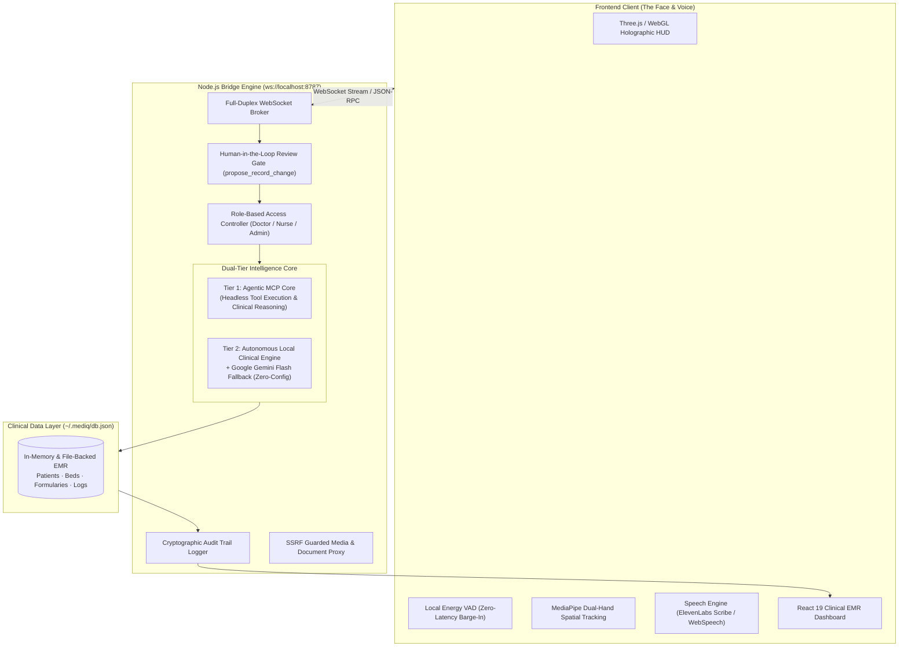

# M.E.D.I.Q.
### Autonomous Voice-First Clinical Intelligence & Hospital Management System

[](https://www.typescriptlang.org/)
[](https://react.dev/)
[](https://threejs.org/)
[](https://nodejs.org/)
[](https://vitejs.dev/)
[](#-clinical-safety--human-in-the-loop-architecture)
[](LICENSE)

**MEDIQ** is a voice-first, touchless clinical intelligence platform designed for high-acuity hospital environments. Combining real-time voice activity detection (VAD), MediaPipe dual-hand spatial gestures, and a multi-tiered reasoning engine, MEDIQ empowers clinicians to triage admitted patients, cross-reference pharmacology interactions, and dictate structured SOAP notes completely hands-free while maintaining a strict zero-unauthorized-mutation safety perimeter.

```bash
# 60-Second Quickstart (Runs standalone out-of-the-box)
npm install
npm start
# Open http://localhost:5173 in Google Chrome or Microsoft Edge
```

---

## 🏛️ System Architecture

MEDIQ is engineered as a decoupled, event-driven distributed system separating real-time audio/spatial interaction in the browser from clinical intelligence reasoning and data persistence in the Node.js bridge.



---

## ⚡ Key Capabilities & Technical Features

| Module | Implementation | Capabilities |
| :--- | :--- | :--- |
| **Dual-Tier Reasoning Core** | `bridge/server.mjs`<br>`bridge/clinical-engine.mjs` | **Tier 1:** Full MCP tool invocation powered by an agentic LLM runtime with tool execution.<br>**Tier 2:** Grounded, zero-dependency clinical fallback engine with deterministic triage and optional Google Gemini Flash integration. |
| **Touchless Spatial Gestures** | `@mediapipe/tasks-vision`<br>`src/lib/hands.ts` | 21-point dual-hand landmark detection. Pinch-to-inspect charts, two-hand viewport scaling, panel docking, and off-screen window dismissal. |
| **Deterministic Pharmacology Engine** | `bridge/mediq.mjs`<br>WHO ATC Classification | Real-time automated drug-drug interaction detection, severity classification, and cross-allergen contraindication screening prior to prescription drafting. |
| **Voice-Driven SOAP Notes** | `src/ui/Mediq.tsx`<br>`propose_record_change` | Real-time clinical dictation structured into standardized Subjective, Objective, Assessment, and Plan records. |
| **Zero-Mutation Safety Gate** | `bridge/mediq.mjs`<br>`decideTool()` | Air-gapped write protection: AI models are sandboxed to drafting changes. Zero modifications are written to patient records without explicit signed clinician confirmation. |
| **Role-Based Access Control (RBAC)**| `PERMISSIONS` matrix | Granular authorization separating Doctor (prescribe/diagnose), Nurse (vitals/triage/admissions), and Administrator credentials. |
| **Resilient Voice Pipeline** | Local Energy VAD + ElevenLabs / WebSpeech | Instant barge-in interruption. Automatically detects ElevenLabs API credentials for high-fidelity audio or falls back seamlessly to browser speech APIs. |

---

## 🛡️ Clinical Safety & Human-in-the-Loop Architecture

In safety-critical medical informatics, unconstrained LLM write permissions present unacceptable patient risks. MEDIQ enforces an ironclad **propose-and-confirm lifecycle**:

1. **Staged Proposals Only:** When a clinician dictates a prescription or note, the model invokes `propose_record_change`. The payload is staged in an isolated pending queue with full diff attribution and automated interaction warnings.
2. **Deterministic Pre-Screening:** The clinical engine parses all proposed medications against the patient's known allergies and existing active regimens before human presentation.
3. **Mandatory Clinician Sign-Off:** The modifications remain uncommitted until an authorized clinician reviews the staged diff on the **Review** tab and confirms via cryptographic session authorization.
4. **Immutable Audit Trail:** Every query, proposal, rejection, and confirmation is permanently written with timestamps and clinician IDs to the hospital audit ledger.

---

## 📋 Prerequisites & Environments

MEDIQ is designed to run in both production cloud configurations and lightweight, zero-cost developer sandboxes:

* **Node.js:** v20.0.0 or higher
* **Browser:** Google Chrome or Microsoft Edge (requires WebGL and Web Audio permissions; embedded editor panes block microphone access).
* **AI Engine Options (Dual-Tier Flexibility):**
  * **Option A (Autonomous / Free):** Runs immediately with zero configuration using the built-in deterministic clinical intelligence engine. Add `GEMINI_API_KEY` for optional Gemini Flash acceleration.
  * **Option B (Full Agent Runtime):** Authenticate via the agent CLI or environment configuration. The bridge automatically links your local MCP tools and agent session to drive deep clinical reasoning without manual orchestration.
* **Audio (Optional):** Add `ELEVENLABS_API_KEY` to enable ElevenLabs Scribe STT and low-latency synthetic voices; otherwise native browser Web Speech handles audio input and output.

---

## 🚀 Quickstart & Execution

### 1. Clone & Install Dependencies
```bash
git clone https://github.com/GurkiratA/MEDIQ.git
cd MEDIQ
npm install
```

### 2. Launch MEDIQ
To launch both the Node.js bridge engine and the React Vite frontend concurrently:
```bash
npm start
```
*Alternatively, run in separate terminals:*
```bash
# Terminal 1: Clinical Bridge Engine (Port 8787)
npm run bridge

# Terminal 2: Holographic HUD Frontend (Port 5173)
npm run dev
```

### 3. Initialize & Operate
1. Open **http://localhost:5173** in Google Chrome or Microsoft Edge.
2. Click **INITIALISE** to prime the Web Audio context.
3. Allow microphone permissions when prompted.
4. Say **"Hey MEDIQ"** (or press **Space**) to query the clinical engine.
5. Press **M** to expand the full clinical dashboard.

---

## 🎯 Clinical Queries & Voice Commands

| Category | Example Voice Query | Triggered Engine Tool |
| :--- | :--- | :--- |
| **Triage & Acuity** | *"Which admitted patients are flagged as critical?"* | `mediq_overview` / `find_patients` |
| **Chart Inspection** | *"Open Margaret Chen's medical record."* | `get_patient_chart` |
| **Pharmacology Screening**| *"Are there any contraindications if I prescribe ibuprofen to Priya Raman?"* | `check_interactions` |
| **Bed Management** | *"What is our current bed occupancy in ICU and Step-Down?"* | `get_room_board` |
| **SOAP Documentation** | *"Clinical note for Rahul Mehta: Patient reports persistent dry cough and mild dyspnea. Oxygen saturation 94% on room air."* | `propose_record_change` (`soap_note`) |
| **Differential Guidance** | *"Differential diagnosis for sudden hypoxia in room 302."* | `differential_guidance` |
| **Multilingual Patient Care**| *"Tell Sofia Alvarez her chest X-ray showed no signs of consolidation, in Spanish."* | `speak_translation` |

---

## 🎮 Interface & Tactical Controls

| Control | Action | Function |
| :--- | :--- | :--- |
| **`Space`** | Push-to-Talk | Instantly streams voice without requiring the wake word. |
| **`M`** | Toggle Dashboard | Opens/closes the comprehensive clinical EMR view. |
| **`G`** | Gesture Control | Engages camera-based MediaPipe hand gesture tracking. |
| **`V`** | Cycle TTS Engine | Switches between native browser voices and cloud synthesizers. |
| **`D`** | Diagnostics | Displays real-time WebGL frame metrics, audio decibel levels, and bridge telemetry. |
| **`T`** | Audio Loopback Test | Executes an automated one-line STT/TTS self-test. |
| **`Escape`** | Stand Down | Immediately terminates active speech synthesis and listening loops. |

---

## ⚙️ Configuration Reference

### Bridge Server Environment (`.env` or process variables)

| Variable | Default | Description |
| :--- | :--- | :--- |
| `MEDIQ_BRIDGE_PORT` | `8787` | WebSocket and HTTP bridge listening port. |
| `MEDIQ_MODEL` | `claude-opus-5` | Primary model identifier for the agent intelligence engine. |
| `MEDIQ_EFFORT` | `medium` | Reasoning effort level for complex clinical planning. |
| `GEMINI_API_KEY` | — | *(Optional)* Powers Google Gemini Flash for the autonomous fallback engine. |
| `ELEVENLABS_API_KEY`| — | *(Optional)* Activates ElevenLabs voice synthesis and Scribe transcription. |
| `MEDIQ_ALLOW_WRITES`| `0` | Default-deny write flag (`1` unlocks effectful external tools). |

### Frontend Client Environment (`.env.local`)

| Variable | Default | Description |
| :--- | :--- | :--- |
| `VITE_BACKEND` | `bridge` | Direct API mode vs. Node bridge proxy mode. |
| `VITE_BRIDGE_URL` | `ws://localhost:8787` | WebSocket address of the backend bridge. |
| `VITE_TTS_ENGINE` | `system` | Primary TTS engine (`system` or `kokoro`). |

---

## 🔒 Security, Compliance & Data Privacy

* **Network Boundary Enforcement:** Bridge WebSocket connections reject all unauthorized cross-origin requests (`MEDIQ_ALLOWED_ORIGINS`).
* **Zero-Leak SSRF Protection:** Media, telemetry, and external document endpoints validate schemes, resolve absolute physical paths, and strictly reject private/loopback RFC-1918 subnets.
* **Content Security Policy (CSP):** The frontend enforces a strict CSP preventing arbitrary script injection; model-generated diagnostic panels are sanitized via DOMPurify with strict HTML tag and attribute allowlists.
* **Demonstration Data Notice:** MEDIQ is seeded with fictional demonstration patient profiles (`~/.mediq/db.json`). It is an assistive decision-support prototype and must not be used with real-world protected health information (PHI) without production HIPAA/PIPEDA compliance hardening and regulatory clearance.

---

## 📄 License
This project is licensed under the [MIT License](LICENSE).
