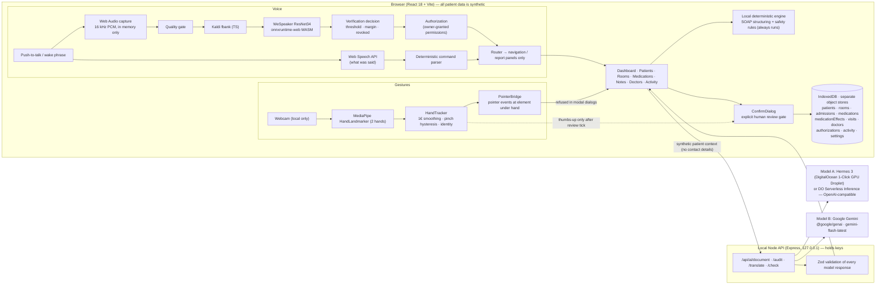

# MEDIQ architecture

## Principles

- **Local-first.** With no keys, no network and no server, every feature works on labelled deterministic fallbacks. Voice verification and gestures always run on-device.
- **Secrets are server-only.** Provider keys exist only in the Node process, loaded from `.env` or from session memory. The browser only calls `/api/*` on the same origin. `npm run check:secrets` scans the built bundle.
- **Human-in-the-loop.** AI output, voice and gestures can only *navigate* or *prepare a draft*. Saving notes, changing admissions or rooms, recording reviews, and changing authorization all go through `ConfirmDialog`, which:
  - shows the target, the proposed change, the source, the warnings and the exact content;
  - requires an "I have reviewed…" tick before anything can be confirmed;
  - keeps Cancel available at all times.

  Profile changes additionally need owner voice re-verification, and gestures are disabled for them.
- **Provenance everywhere.** Every displayed result carries a tag for its source: Gemini, Hermes, Local deterministic fallback, Local Deterministic Safety Rule, Record-derived, Original text, Clinician-confirmed, or Simulation.
- **Pure core, thin UI.** The following are pure, unit-tested modules:
  - room allocation rules (`src/db/allocation.ts`);
  - the command parser and router (`src/voice/commands.ts`, `router.ts`);
  - the verification decision (`src/voice/verification.ts`);
  - the sample quality checks (`quality.ts`);
  - the fbank front end (`fbank.ts`);
  - gesture classification (`src/gestures/classifier.ts`);
  - the local clinical engine (`src/ai/localEngine.ts`).

## Directory map

| Path | Contents |
|---|---|
| `src/db/` | Zod schemas, seed data, IndexedDB repository (`database.ts`), allocation rules |
| `src/state/` | React contexts: data, navigation, note drafts, providers, toasts, confirmation bus |
| `src/voice/` | Capture, quality, fbank, speaker model, verification, recogniser, TTS, commands, router, orchestrator |
| `src/gestures/` | Hand tracker, pointer bridge, scroll gesture, static-pose classifier (thumbs-up/open palm), MediaPipe controller, overlay, camera tile |
| `src/reports/` | Floating report panels: store, two-hand resizer, report bodies, launchers |
| `src/intro/` | Start-up sequence |
| `src/ai/` | Browser AI client (fallback orchestration), local engine, ATC drug-class table, demo scenario |
| `src/views/` | Screens and dialogs |
| `server/` | Express API, provider clients, prompts, config/redaction |
| `shared/` | AI request/response schemas shared by browser and server |
| `e2e/` | Playwright tests (demo path and live voice pipeline) |
| `scripts/` | Postinstall WASM copy, model setup, secret scan, speaker-model evaluation |
