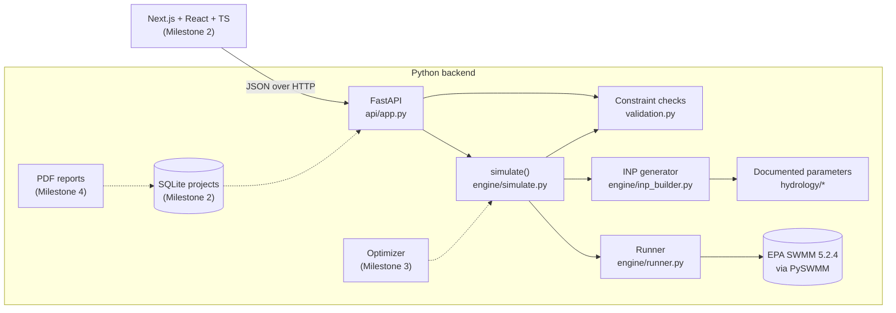

# Architecture

## Layers

| Layer | Module | Responsibility |
|---|---|---|
| Domain model | `models/project.py`, `models/results.py` | Pydantic schemas: the single source of truth for project files, API bodies and saved results |
| Parameters | `hydrology/` | Soil, surface and rainfall assumptions, each with a cited source |
| Validation | `validation.py` | Geometry and budget constraints; returns structured `Issue`s |
| Model generation | `engine/inp_builder.py` | Pure function: (site, design, scenario) → SWMM `.inp` text |
| Execution | `engine/runner.py` | Runs SWMM in a temp dir, parses stats and the binary `.out` file |
| API | `api/app.py` | Thin HTTP layer; maps validation failures to 422 and engine failures to 500 with SWMM's message |

## Key decisions

- **Rectangles, not GIS polygons.** Surfaces and interventions are
  axis-aligned rectangles in metres. This keeps overlap and containment
  checks exact and the SVG editor simple. It is plenty for parking lots and
  campus blocks, and the model can be extended later.
- **One SWMM subcatchment per surface.** Each surface maps directly to one
  subcatchment, so results line up with what the user drew.
- **LIDs as SWMM LID controls**, with one control per intervention. Each
  intervention gets its own geometry and its own water balance.
- **Validate before simulating.** An infeasible design never reaches SWMM,
  so the UI can never show results for a layout that breaks the rules.
- **SWMM is single-instance per process.** The runner holds a lock. The
  optimizer will evaluate candidates in separate worker processes. One run on
  the sample site takes about 0.15 s, so a few hundred candidates will finish
  in well under a minute.
